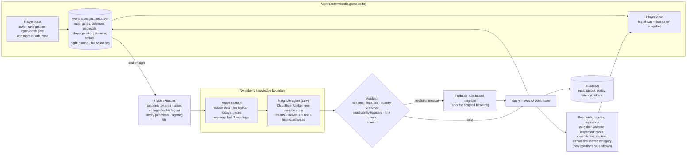

AI-use disclosure: Claude (Claude Code) drew this diagram from the GDD and Configuration Document; I reviewed the boundary it shows.

# Gnome Heist: Systems diagram (G1, planned)

The diagram shows the five required elements: state, player input, agent context and actions, validation, and feedback. The dashed box is the neighbor agent's knowledge boundary: only the trace list, his own layout, and his memory cross into it. Nothing here is implemented yet.

What the neighbor **never** receives: the player's path, position, stamina, strikes, remaining nights, fog memory, or intent. See [Configuration Document, Section A2](configuration.md#a2-world-state-and-what-the-agent-knows).
